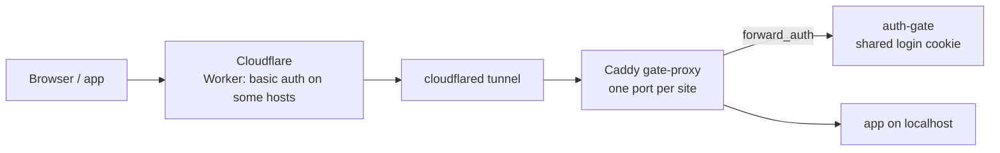

# homelab-edge

How the outside world reaches the homelab: no ports open on the router.



| Public host | Caddy port | App |
|---|---|---|
| `media.` | 8097 | Jellyfin |
| `music.` | 4534 | Navidrome (Subsonic apps use HTTP basic auth on `/rest/*`) |
| `requests.` | 5099 | Seerr |
| `music-requests.` | 3599 | Aurral |
| `home.` | 3006 | Homepage dashboard |
| `books.` | 8185 | Calibre-Web-Automated (`/opds`, `/kosync`, `/kobo/*` skip the gate; the reader apps log in with their Calibre-Web account) |
| `book-requests.` | 8186 | Shelfmark |

## Files

- `gate/Caddyfile`: the sites above; `{$VARS}` come from `.env`.
- `gate/auth_gate.py` + `gate/Dockerfile`: a ~100-line shared-password gate with an HMAC-signed cookie and same-site redirects only.
- `cloudflared/config.example.yml`: tunnel ingress; the real file lives in `${APPDATA}/cloudflared/` with the tunnel credentials.
- `worker/`: optional Cloudflare Worker that adds HTTP basic auth in front of chosen hosts.

## Deploy

```bash
cp .env.example .env   # gate password, cookie secret, Subsonic guest hash
docker compose up -d --build
# new public host: add it to ${APPDATA}/cloudflared/config.yml, then
docker exec cloudflared cloudflared tunnel route dns <TUNNEL_ID> new.example.com
```

A maintained alternative to `auth_gate.py` is [tinyauth](https://github.com/steveiliop56/tinyauth)
(per-user accounts, TOTP, OAuth); it plugs into the same `forward_auth` lines.
